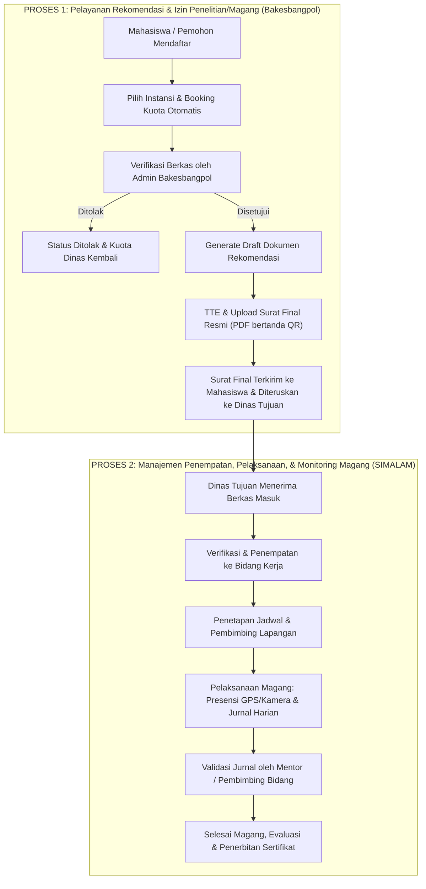

# Layanan Elektronik Terpadu Evaluasi dan Rekomendasi (LENTERA)
### Pemerintah Kabupaten Bogor

LENTERA adalah sistem informasi berbasis web yang memfasilitasi pelayanan publik secara elektronik di lingkungan Pemerintah Kabupaten Bogor, khususnya dalam proses pendaftaran, evaluasi, penerbitan rekomendasi izin penelitian/PKL/magang (Bakesbangpol), serta manajemen operasional penempatan, absensi, dan jurnal magang (SIMALAM) di seluruh Organisasi Perangkat Daerah (OPD) dan Kecamatan.

---

## Arsitektur Proses

Sistem LENTERA mengintegrasikan dua proses bisnis besar lintas stakeholder ke dalam satu alur layanan terpadu:



### Stakeholder & Peran

| Stakeholder | Role Pengguna | Tanggung Jawab Utama |
|---|---|---|
| **Pemohon / Mahasiswa** | `peserta` / `user` | Mengajukan permohonan layanan/magang, melihat status, mengunduh Surat Rekomendasi Final, mencatat kehadiran (GPS/Foto), dan mengisi jurnal harian. |
| **Bakesbangpol** | `kesbangpol` | Memverifikasi kelayakan berkas izin/penelitian/magang, menerbitkan draft rekomendasi, mengunggah Surat Rekomendasi Final bertanda tangan elektronik, dan memantau riwayat pemohon di tingkat kabupaten. |
| **Dinas / OPD / Kecamatan** | `dinas` | Mengelola kuota penerimaan magang, menyetujui mahasiswa yang direkomendasikan Bakesbangpol, menempatkan peserta ke bidang internal, dan memantau kehadiran serta progress tugas. |
| **Bidang Internal OPD** | `bidang` | Menjadi mentor/pembimbing teknis lapangan, memverifikasi jurnal harian kegiatan mahasiswa, dan memberikan evaluasi kinerja tugas. |
| **Super Administrator** | `superadmin` / `admin` | Pengawasan sistem terpusat, manajemen master data dinas dan akun perangkat daerah, audit sistem, dan pemantauan lintas instansi (switch-instansi). |

### Alur Detail Dua Proses Besar

#### Proses 1: Pelayanan Rekomendasi & Izin Penelitian/Magang (Bakesbangpol)
1. **Pendaftaran Terpadu**: Mahasiswa memilih jenis pelayanan (mis. Izin Penelitian, Praktik Kerja Lapangan, KKL/Magang Mahasiswa) dan memilih instansi tujuan.
2. **Booking Kuota Real-Time**: Ketika mahasiswa mengajukan permohonan, kuota dinas tujuan langsung terpotong secara transaksional (`status: menunggu`).
3. **Verifikasi Bakesbangpol**: Petugas Bakesbangpol memeriksa kesesuaian berkas identitas, proposal, dan surat pengantar kampus.
   - Bila **ditolak**, kuota dinas tujuan otomatis dikembalikan utuh.
   - Bila **disetujui**, sistem menghasilkan dokumen draft rekomendasi dan token verifikasi digital yang unik.
4. **Penerbitan Surat Final**: Pejabat berwenang menandatangani surat secara digital. Admin mengunggah Surat Final resmi (`.pdf`). Mahasiswa hanya dapat mengunduh dokumen Surat Final resmi yang sah, bukan draft internal.
5. **Verifikasi Publik**: Surat dilengkapi QR code yang mengarah ke rute publik `/verifikasi-surat/{token}` untuk memeriksa keaslian nomor surat, nama pemohon, dan instansi tujuan tanpa mengekspos data pribadi sensitif (NIK, email, nomor HP).

#### Proses 2: Manajemen Penempatan, Pelaksanaan, & Monitoring Magang (SIMALAM)
1. **Penerimaan di Instansi Tujuan**: Berkas permohonan yang disetujui Bakesbangpol langsung tampil pada dashboard dinas terkait. Admin dinas memverifikasi dan menyetujui penempatan ke salah satu Bidang internal.
2. **Penugasan & Jadwal**: Peserta magang mendapatkan jadwal kerja (WFO/WFH) dan ditautkan ke Pembimbing/Mentor Bidang yang bersangkutan.
3. **Aktivitas Harian Terintegrasi**: Mahasiswa melakukan presensi harian berbasis koordinat GPS dan foto selfie serta mencatat logbook jurnal harian kegiatan magang.
4. **Bimbingan & Validasi**: Pembimbing Bidang memeriksa dan memvalidasi logbook jurnal peserta secara berkala.
5. **Penyelesaian & Sertifikat**: Setelah periode magang berakhir, instansi mencetak rekapitulasi kehadiran dan menerbitkan sertifikat magang.

---

## Teknologi yang Digunakan

- **Framework**: Laravel 13.x
- **Bahasa Pemrograman**: PHP 8.3+
- **Database**: MySQL / MariaDB (Didukung SQLite in-memory untuk testing)
- **Frontend**: Blade Templating, Tailwind CSS, Alpine.js, Bootstrap 5.3 (modular)
- **Pengolah Dokumen**: PHPWord / DocxTemplate, DOMPDF, Simple QR Code, Maatwebsite Excel

---

## Konfigurasi Sistem (`config/lentera.php`)

Pengaturan sentral aplikasi LENTERA dikelola melalui file [config/lentera.php](file:///c:/laragon/www/Lentera_Kab.Bogor/config/lentera.php) dan variabel lingkungan `.env`:

```php
return [
    // Batas maksimum upload berkas pendukung dan surat final (dalam Kilobyte)
    'max_upload_size' => 2048,

    // Default kuota peserta magang per dinas jika belum dispesifikasikan
    'default_quota' => 10,

    // Masa berlaku Surat Rekomendasi (dalam hari) sebelum kedaluwarsa jika belum diproses dinas
    'masa_berlaku_surat_hari' => (int) env('LENTERA_MASA_BERLAKU_SURAT_HARI', 30),

    // Batas waktu pengajuan yang belum diverifikasi (dalam hari) sebelum kedaluwarsa otomatis
    'masa_berlaku_pengajuan_hari' => (int) env('LENTERA_MASA_BERLAKU_PENGAJUAN_HARI', 30),

    // Status yang mengunci / memotong kuota dinas
    'status_memakai_kuota' => ['menunggu', 'diterima', 'aktif'],

    // Batas waktu berlakunya token reset password (dalam menit)
    'reset_token_ttl_minutes' => (int) env('RESET_TOKEN_TTL_MINUTES', 60),

    // Pejabat default penandatangan Bakesbangpol
    'pejabat_kesbangpol' => [
        'nama'    => env('KESBANGPOL_PEJABAT_NAMA', 'FERDINANDO SELMI PARDEDE, S.IP, M.AP'),
        'nip'     => env('KESBANGPOL_PEJABAT_NIP', '196805121990031005'),
        'pangkat' => env('KESBANGPOL_PEJABAT_PANGKAT', 'Pembina Tk. I'),
        'jabatan' => env('KESBANGPOL_PEJABAT_JABATAN', 'KEPALA BADAN KESATUAN BANGSA DAN POLITIK KABUPATEN BOGOR'),
    ],
];
```

Variabel lingkungan opsional yang dapat ditambahkan pada file `.env`:
```ini
LENTERA_MASA_BERLAKU_SURAT_HARI=30
LENTERA_MASA_BERLAKU_PENGAJUAN_HARI=30
RESET_TOKEN_TTL_MINUTES=60
KESBANGPOL_PEJABAT_NAMA="FERDINANDO SELMI PARDEDE, S.IP, M.AP"
KESBANGPOL_PEJABAT_NIP="196805121990031005"
KESBANGPOL_PEJABAT_PANGKAT="Pembina Tk. I"
KESBANGPOL_PEJABAT_JABATAN="KEPALA BADAN KESATUAN BANGSA DAN POLITIK KABUPATEN BOGOR"
```

---

## Penjadwalan Tugas (Cron & Scheduler)

Sistem LENTERA dilengkapi dengan command otomatisasi kedaluwarsa berkas dan pembersihan kuota ter-booking yang sudah tidak aktif (`lentera:expire-pengajuan`).

### 1. Menjalankan Task Scheduler di Server Production
Tambahkan satu baris *cron entry* berikut pada server Linux (menggunakan `crontab -e`):

```bash
* * * * * cd /path/ke/aplikasi/Lentera_Kab.Bogor && php artisan schedule:run >> /dev/null 2>&1
```

Cron ini akan memicu Laravel scheduler setiap menit. Scheduler secara berkala menjalankan `lentera:expire-pengajuan` setiap hari pada pukul 00:00 untuk:
- Mengidentifikasi permohonan yang mengendap > 30 hari tanpa verifikasi.
- Mengidentifikasi Surat Rekomendasi yang masa berlakunya telah habis sebelum diproses dinas.
- Mengubah status ke `expired`.
- Mengembalikan kuota dinas terkait secara otomatis.
- Mengirimkan notifikasi kedaluwarsa kepada mahasiswa.

### 2. Menjalankan Scheduler di Lingkungan Development
Untuk menguji penjadwalan secara lokal tanpa cron server:
```bash
php artisan schedule:work
```

### 3. Menjalankan Command Secara Manual
Pemeriksaan dan kedaluwarsa dapat dijalankan secara instan kapan saja:
```bash
php artisan lentera:expire-pengajuan
```

Command audit konsistensi master bidang antar-dinas:
```bash
# Menampilkan laporan audit bidang (dinas kosong, duplikasi, pembanding JSON)
php artisan lentera:audit-bidang

# Format output JSON
php artisan lentera:audit-bidang --json

# Menambahkan bidang PIKAP yang sudah terkonfirmasi di Diskominfo
php artisan lentera:audit-bidang --fix-pikap
```

---

## Menjalankan Pengujian (Automated Tests)

Semua pengujian unit dan fitur telah disesuaikan dan siap dijalankan dengan SQLite in-memory:

```bash
# Menjalankan seluruh test suite
php artisan test

# Menjalankan grup pengujian tertentu
php artisan test --filter="AuthSecurityTest"
php artisan test --filter="PrivilegeEscalationTest"
php artisan test --filter="RoleAccessTest"
php artisan test --filter="DinasIsolationTest"
php artisan test --filter="KuotaBookingTest"
php artisan test --filter="ExpirePengajuanTest"
php artisan test --filter="SuratFinalTest"
php artisan test --filter="UploadValidationTest"
```
